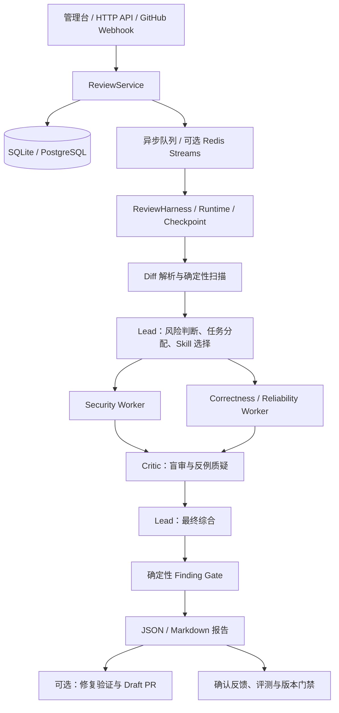

# CodeJudge

**面向 GitHub Pull Request 的多 Agent 代码审查与验证系统。**

CodeJudge 将任务拆解、工具取证、反例审查、证据门禁和反馈评测串成一条完整流程，输出包含代码位置、风险说明、修复建议与测试建议的审查报告。

项目原名 EvoAgent。当前 Python 包名 `evoagent`、配置前缀 `EVOAGENT_` 和修复分支前缀保持兼容，文档使用 CodeJudge 作为展示名称。

## 核心能力

| 模块 | 实现 |
| --- | --- |
| 多 Agent 协作 | Lead 分工，Security 与 Correctness/Reliability Worker 并行取证，Critic 盲审候选，Lead 综合 |
| 自研运行时 | 有界 Agent Loop、Tool Registry、参数 Schema 校验、结构化 Observation、角色权限与执行预算 |
| 状态恢复 | 持久化任务、执行轨迹与 Checkpoint，支持取消及断点续跑 |
| 上下文与记忆 | 风险优先的 Diff 裁剪、历史 Observation 压缩、按需加载 Skill、租户/仓库隔离检索 |
| 证据门禁 | 确定性校验问题位置、证据、置信度以及高风险问题的修复和测试建议 |
| 修复验证 | 补丁处理、AST/CST 检查、前后测试对比与 Draft PR 修复流程 |
| 反馈迭代 | 误报/漏报/错误修复反馈、Prompt / Skill 候选评测、版本激活与回滚 |
| 服务治理 | Web 管理台、RBAC、租户隔离、审计、Prometheus 指标与 OpenTelemetry |
| 异步执行 | 本地进程队列；可选 Redis Streams、ACK、租约、退避重试与死信重放 |

## 架构与流程



1. **接收任务：** 接收统一 Diff 或 GitHub PR 事件，保存任务并启动审查。
2. **分工取证：** Lead 选择 Skill 并委派任务；Worker 调用代码搜索、文件读取、AST 分析、扫描器及仓库检查等工具。
3. **交叉验证：** Critic 隐去候选来源后检查错误位置、缺失前提、反例和严重性。Worker 之间不直接通信，由 Lead 协调。
4. **发布门禁：** Lead 综合后，Finding Gate 使用确定性规则校验候选，只有通过的结果进入报告。
5. **反馈闭环：** 确认反馈进入记忆与评测流程，候选 Prompt / Skill 经过改进与不退化门禁后才允许激活。

普通任务采用固定单轮协作，包含 Lead 分配与综合、两个 Worker、一次 Critic；高风险任务最多允许一轮 Worker 返工。各角色可在预算内调用工具，因此实际 LLM 调用次数取决于取证步骤。

## 快速开始

### 1. 安装

使用 Python 3.11 或以上版本。以下命令以 Windows PowerShell 为例：

```powershell
git clone https://github.com/gbh1234/CodeJudge.git
cd CodeJudge
python -m venv .venv
.\.venv\Scripts\Activate.ps1
python -m pip install -r requirements.txt
Copy-Item .env.example .env
```

### 2. 配置模型与登录

在本地 `.env` 中填写配置。以下值均为占位符，必须替换：

```dotenv
EVOAGENT_LLM_PROVIDER=custom
EVOAGENT_LLM_BASE_URL=https://your-model-provider.example/v1
EVOAGENT_LLM_API_KEY=replace-with-your-api-key
EVOAGENT_LLM_MODEL=replace-with-your-model-name
EVOAGENT_AUTH_REQUIRED=true
EVOAGENT_AUTH_SECRET=replace-with-a-random-secret-of-at-least-32-characters
EVOAGENT_BOOTSTRAP_ADMIN_USERNAME=admin
EVOAGENT_BOOTSTRAP_ADMIN_PASSWORD=replace-with-a-strong-password
```

可在本地生成随机登录签名密钥：

```powershell
python -c "import secrets; print(secrets.token_urlsafe(48))"
```

也支持 `deepseek`、`openrouter-deepseek-free` 和 `openrouter-free` Provider，分别使用 `EVOAGENT_DEEPSEEK_API_KEY` 或 `EVOAGENT_OPENROUTER_API_KEY`。模型默认值见 [配置实现](evoagent/config.py)，可通过 `EVOAGENT_LLM_MODEL` 覆盖，是否可用以模型提供方为准。

配置优先级：进程环境变量 > 根目录 `.env` > 兼容路径 `evoagent/.env`。修改配置后需重启服务。

> 默认 Provider `local` 允许服务在没有模型配置时启动，但不能提交 Agentic 审查。执行审查前必须配置模型。

### 3. 启动

```powershell
python -m evoagent
```

打开 [本地管理台](http://127.0.0.1:8080/)，使用配置的管理员账号登录。健康检查路径为 `/health`。Bootstrap 管理员只在用户名不存在时创建，重启不会覆盖已有账号密码。

### 4. 提交审查

下面安全读取密码，提交一个用于演示的风险 Diff：

```powershell
$credential = Get-Credential -UserName 'admin' -Message '输入 CodeJudge 管理员密码'
$session = Invoke-RestMethod -Method Post -Uri http://127.0.0.1:8080/v1/auth/login `
  -ContentType 'application/json' `
  -Body (@{
    username = $credential.UserName
    password = $credential.GetNetworkCredential().Password
  } | ConvertTo-Json)
$headers = @{ Authorization = "Bearer $($session.access_token)" }
$request = @{
  repository = 'demo/api'
  pull_request = 12
  mode = 'agentic'
  diff = "diff --git a/app.py b/app.py`n--- a/app.py`n+++ b/app.py`n@@ -0,0 +1 @@`n+eval(user_input)`n"
}
$task = Invoke-RestMethod -Method Post `
  -Uri 'http://127.0.0.1:8080/v1/reviews?async=true' `
  -Headers $headers -ContentType 'application/json' `
  -Body ($request | ConvertTo-Json)
Invoke-RestMethod -Headers $headers `
  -Uri "http://127.0.0.1:8080/v1/tasks/$($task.task_id)"
```

任务异步执行，可在管理台跟踪进度。完成后通过 `GET /v1/tasks/{id}/report` 获取 Markdown 报告。根目录的 `test.py`、`test1.py`、`test2.py` 也提供交互式演示，运行前需先启动服务。

## 接入 GitHub

推荐使用 **仓库 Webhook + fine-grained PAT**，不要求安装 GitHub App。

1. 配置随机的 `EVOAGENT_GITHUB_WEBHOOK_SECRET`，与登录密钥分开设置。
2. 按需设置 `EVOAGENT_GITHUB_TOKEN`；公开仓库只读且不回写时可不配置。
3. 将公网 HTTPS 地址转发到本地服务，在仓库 **Settings → Webhooks** 添加 `https://<你的域名>/webhooks/github`。
4. Content type 选择 `application/json`，Secret 与本地一致，只订阅 **Pull requests**。
5. 创建、重新打开 PR 或推送提交，在 Recent Deliveries 和管理台核对任务状态。

处理 `opened`、`reopened`、`synchronize` 三种动作。Webhook 使用 HMAC-SHA256 签名认证，包含 delivery 幂等与重放时间窗校验。设置 `EVOAGENT_AUTO_POST_REVIEW=true` 后启用评论更新或创建，默认关闭。

| 功能 | fine-grained PAT 最小权限 |
| --- | --- |
| 私有仓库 Diff 读取 | Contents: Read；Pull requests: Read |
| PR 评论回写 | Pull requests: Read and write |
| 创建修复分支与 Draft PR | Contents: Read and write；Pull requests: Read and write |

本地可用自行安装的 `cloudflared` 或 `ngrok` 转发。临时地址改变后需更新 Payload URL。公网部署保持认证开启，建议通过反向代理只公开 Webhook 和必要的健康检查。

修复结果写入新的 `evoagent/fix-pr-*` 分支，保留人工审阅。通过 `EVOAGENT_REPAIR_TEST_COMMAND` 配置测试命令；未配置或未执行测试时不能视为已通过测试验证。执行仓库代码和检查命令时，应使用受限且无生产凭据的隔离环境。

## 按需加载 Skill

Skill 提供审查步骤、证据标准和输出约束，工具由 Runtime 和 `RepositoryToolSuite` 提供。Lead 发现时只看到名称与描述，选中后才把正文及资源暴露给对应 Worker。

内置领域包括：安全、正确性、可靠性、性能、数据库、API 兼容性、测试质量、可观测性和代码质量。

```text
skills/<skill-name>/
└── SKILL.md    # YAML frontmatter + 完整审查协议
```

YAML 元数据包含 `name`、`description`、`allowed-tools`；`name` 与目录名一致。正文包含任务边界、调查流程、误报排除、严重性标准、修复验证和输出字段。参考 [安全审查 Skill](skills/security-review/SKILL.md)。

最终工具权限取角色权限与 Skill 声明的交集。文本资源限于包目录内读取；`POST /v1/skills/reload` 可为后续任务重新加载 Skill。

## 反馈、评测与版本迭代

```text
确认反馈 → 生成候选 → 与基线对照评测 → 验证集改进
       → 独立保留集不退化 / 高风险保护 → 激活或保留候选 → 可回滚
```

Prompt 版本与 Skill artifact 分别管理。评测关注 Precision、Recall、F1、高风险召回、严重性及干净样本表现，并记录模型、数据集和版本。消融支持比较单模型、模型加扫描器、无 Critic 多 Agent、完整多 Agent，以及可选的演进 Skill。

```powershell
# 查看参数，不产生模型调用
python scripts/run_agentic_evaluation.py --help
python scripts/run_skill_evolution_experiment.py --help
python scripts/run_prompt_evolution_proof.py --help

# 真实模型评测：提前设置 EVOAGENT_LLM_BASE_URL / API_KEY / MODEL
python scripts/run_agentic_evaluation.py path/to/labelled-prs.jsonl
```

真实模型评测会产生 API 调用和费用。`pr_diff_100.jsonl` 是受控实验样本，用于流程验证和实验调试，其结果不代表真实公开 PR 的泛化效果。准确率及提升幅度需以对应数据集、模型、预算与重复实验报告为准，本 README 不预设效果数字。

## 持久化与部署

| 配置 | 本地默认 | 可选部署 |
| --- | --- | --- |
| 数据库 | SQLite，`evoagent.db` | `EVOAGENT_DATABASE_URL` 指定 PostgreSQL |
| 队列 | 进程内异步执行 | `EVOAGENT_REDIS_URL` 指定 Redis Streams |
| 并发 | `EVOAGENT_ASYNC_WORKERS=2` | 按模型配额及服务资源调整 |
| 指标 | `/metrics` | Prometheus 采集 |
| 链路 | 持久化执行轨迹 | `EVOAGENT_OTEL_ENDPOINT` 对接 OTLP |

仓库提供 [Dockerfile](Dockerfile) 与 [Compose 配置](docker-compose.yml)：

```powershell
docker compose up --build -d
docker compose logs -f evoagent
```

Compose 同时启动应用、PostgreSQL 和 Redis。启动前在 `.env` 设置模型、`EVOAGENT_AUTH_SECRET` 和 `EVOAGENT_BOOTSTRAP_ADMIN_PASSWORD`。Compose 中数据库账号与登录后备值仅用于本地演示；正式部署应替换数据库凭据、移除示例后备值并配置 HTTPS、备份及网络限制。

常用预算配置：

| 参数 | 初始值 | 作用 |
| --- | --- | --- |
| `EVOAGENT_MAX_DIFF_BYTES` | `1048576` | Diff 字节上限 |
| `EVOAGENT_MAX_STEPS` | `8` | Harness 步数预算 |
| `EVOAGENT_TIMEOUT_SECONDS` | `120` | 任务时间预算配置 |
| `EVOAGENT_AGENT_TOKEN_BUDGET` | `8000` | 单角色 Token 预算配置 |
| `EVOAGENT_AGENT_TIME_BUDGET_SECONDS` | `60` | 单角色时间预算配置 |
| `EVOAGENT_CONTEXT_DIFF_TOKEN_BUDGET` | `12000` | Diff 上下文预算 |
| `EVOAGENT_QUEUE_MAX_ATTEMPTS` | `3` | 队列最大尝试次数 |
| `EVOAGENT_QUEUE_LEASE_SECONDS` | `60` | Worker 租约时间 |

全部配置见 [.env.example](.env.example) 与 [config.py](evoagent/config.py)。

## API 概览

启用认证后业务接口需携带 Bearer Token；Webhook 使用独立签名认证。

| 方法 | 路径 | 用途 |
| --- | --- | --- |
| GET | `/health` | 健康检查 |
| POST | `/v1/auth/login` | 获取租户绑定的会话 Token |
| POST | `/v1/reviews` | 同步审查；`?async=true` 为异步 |
| GET | `/v1/tasks/{id}` | 状态、轨迹与结果 |
| GET | `/v1/tasks/{id}/report` | Markdown 报告 |
| POST | `/v1/tasks/{id}/cancel`、`/resume` | 取消或续跑 |
| GET / POST | `/v1/tasks/{id}/feedback` | 查询或提交反馈 |
| POST | `/v1/tasks/{id}/fix` | 触发修复 |
| POST | `/webhooks/github` | 接收 PR 事件 |
| POST | `/v1/skills/reload` | 重新加载 Skill |
| POST | `/v1/evolution/auto`、`/propose` | Prompt 候选生成与评测 |
| GET | `/v1/evolution/status`、`/runs` | Prompt 门禁与记录 |
| POST | `/v1/skills/{name}/versions/{version}/activate` | 激活或回滚 Prompt |
| GET / POST | `/v1/evaluation/cases` | 版本化评测样本 |
| POST | `/v1/skill-evolution/auto`、`/propose` | Skill artifact 候选评测 |
| GET | `/v1/skill-evolution/status`、`/runs` | Skill 门禁与记录 |
| GET | `/v1/skill-evolution/{name}/versions` | Skill 版本链 |
| POST | `/v1/skill-evolution/{name}/versions/{version}/activate` | 激活或回滚 Skill |
| GET | `/metrics` | Prometheus 指标 |
| GET | `/api/alerts`、`/api/audit` | 告警与审计 |
| GET | `/api/queue/dead-letters` | 死信任务 |
| POST | `/v1/queue/dead-letters/replay` | 重放死信 |
| GET / POST | `/v1/deployments/llm-review` | 灰度与影子发布 |

## 开发与测试

```powershell
python -m unittest discover -s tests -v
```

测试覆盖 Diff 解析、多 Agent 协作、工具调用、上下文预算、恢复、队列、认证隔离和版本迭代。单元测试验证实现行为，真实模型评测衡量审查效果，两者应分别记录。

当前发布检查（Windows / Python 3.12）：发现 87 项测试；存在 49 个错误和 1 个失败，主要涉及 SQLite 连接未及时释放导致临时数据库无法删除，以及 AST 重写后的单双引号断言差异。此版本尚未达到全量测试通过状态。

```text
evoagent/       服务、运行时、审查、修复与评测实现
skills/         领域审查协议
web/            管理台前端
tests/          自动化测试与 Fake 模型
scripts/        数据导入、对照实验及评测脚本
docs/           流程说明
.env.example    无真实密钥的配置模板
```

## 密钥与发布约定

- 模型密钥、GitHub Token、Webhook Secret 和登录密钥仅放在本地 `.env`、环境变量或部署平台密钥配置中。
- `.gitignore` 排除本地环境文件、私钥、数据库、缓存、日志及审查结果；`.env.example` 保留空值与占位符。
- 隧道程序及机器专属工具配置不随源码发布，按需自行安装。
- 上传前检查待提交文件；忽略规则不会移除已提交的密钥。若密钥曾被公开，应撤销并轮换。
